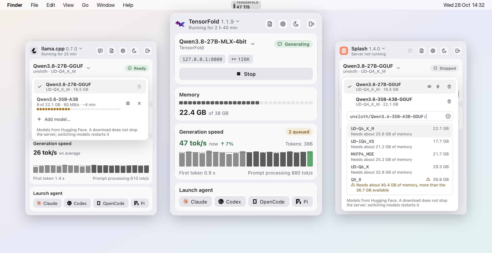
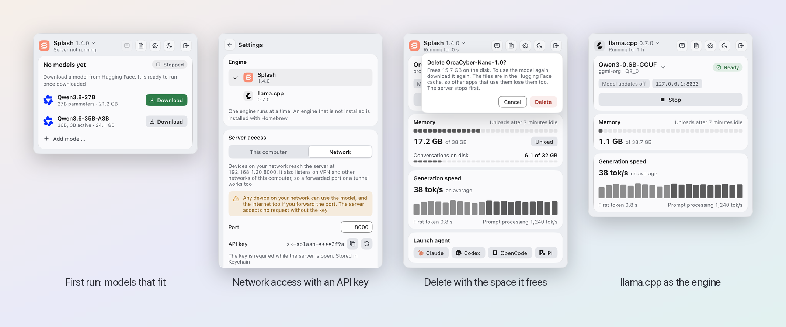
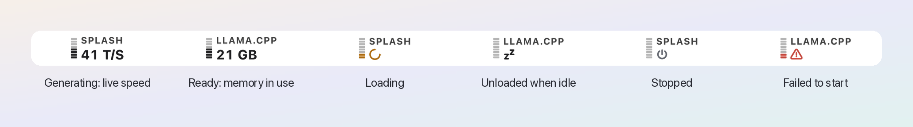
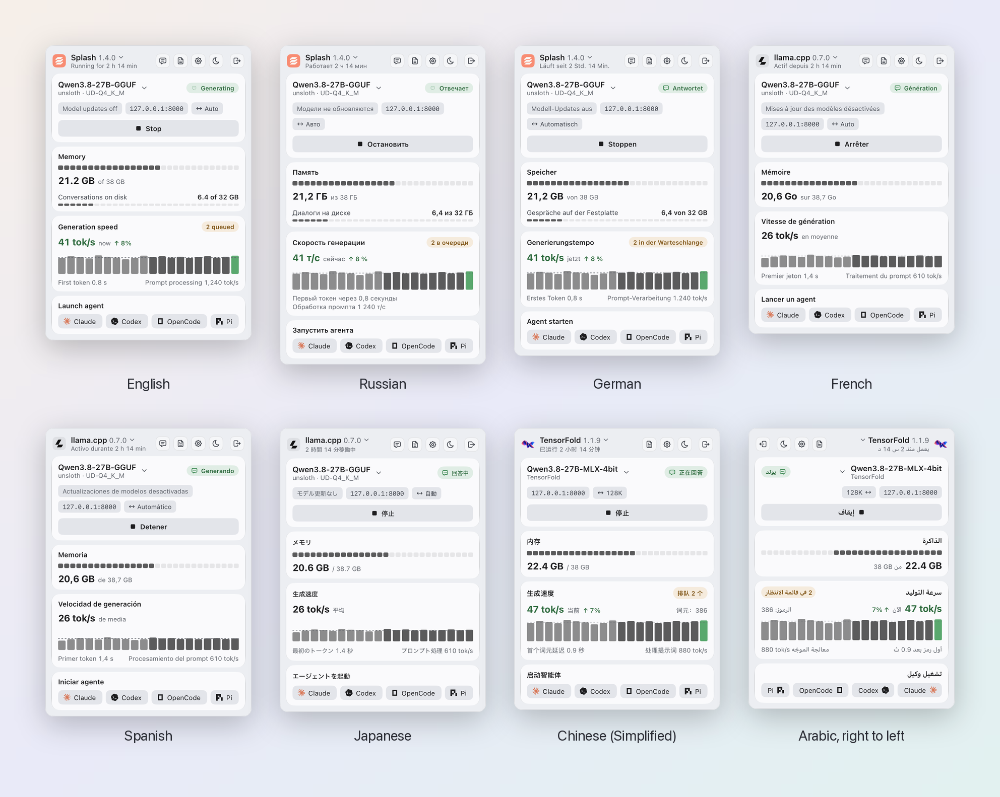

<div align="center">

# Lumilo

**A menu-bar panel for the LLM engines on your Mac.**<br>
Start the server, watch memory and speed, get models from Hugging Face,
and point coding agents at it, without a terminal.

[](https://github.com/kotuke/lumilo/actions/workflows/ci.yml)


[](LICENSE)

<picture>
  <source media="(prefers-color-scheme: dark)" srcset="docs/images/hero-dark.png">
  
</picture>

</div>

Lumilo runs [Splash](https://github.com/incoai/splash) or
[llama.cpp](https://github.com/ggml-org/llama.cpp) (`llama-server`) for you.
It starts and stops the server, shows its state, memory and generation
speed, downloads and deletes models, launches coding agents against it, and
installs or updates the engine. One engine runs at a time; you choose it in
Settings. Engines are pluggable; mlx-serve is planned.

> **Unofficial.** Lumilo is an independent project. It is not affiliated with,
> endorsed by, or supported by the authors of Splash or any other engine it
> controls. Engine names and logos belong to their owners.

## Highlights

- **One click to serve.** Start, stop and restart the server; see whether it
  is loading, ready, generating or unloaded, and why a start failed.
- **Live numbers.** Memory against the engine's budget, tokens per second,
  time to first token, the last 20 requests as a chart, in the menu bar too.
- **Models from Hugging Face.** Search as you type, see each variant's size
  and whether it fits in memory, download beside a running server, delete
  with the space it frees.
- **Coding agents.** Claude Code, Codex, OpenCode or Pi in Terminal, Ghostty
  or Rex, already pointed at the local Splash server.
- **Private by default.** The server listens on this Mac only; network access
  needs an API key, kept in the Keychain.
- **Native and translated.** Liquid Glass, light and dark themes, eight
  languages with a right-to-left layout for Arabic.

<picture>
  <source media="(prefers-color-scheme: dark)" srcset="docs/images/features-dark.png">
  
</picture>

## In the menu bar

The icon tells the state without opening the panel: the bar fills with the
memory the model takes, and the value is the live speed while it generates,
the memory while it waits, or a sign when it loads, sleeps, stops or fails.

<picture>
  <source media="(prefers-color-scheme: dark)" srcset="docs/images/menubar-dark.png">
  
</picture>

## Languages

English, Russian, German, French, Spanish, Japanese, Chinese (Simplified) and
Arabic. Lumilo follows the system language, or the one you pick in Settings.

<picture>
  <source media="(prefers-color-scheme: dark)" srcset="docs/images/languages-dark.png">
  
</picture>

## Install

Signed and notarized builds will be published on the
[Releases](https://github.com/kotuke/lumilo/releases) page as a disk image.
Until the first release, [build Lumilo from source](#build).

## All features

- **Server control.** Start, stop and restart the server with the selected
  model. Lumilo runs it as a child process in its own process group and
  stops it when you quit. A server started elsewhere (for example in a
  terminal) is detected and shown as running outside the panel.
- **State at a glance.** The menu-bar icon shows memory in use or the live
  generation speed. The panel shows loading, ready, generating, unloaded,
  not responding, stopping and error states, with the reason and the last
  log line when a start fails (port in use, missing model, not enough
  memory).
- **Metrics.** Memory against the engine's budget, conversation state on
  disk, average speed over the last 10 requests, the last 20 requests as a
  chart, time to first token and prompt speed.
- **Unload and reload** the model weights without stopping the server, and
  unload automatically when idle. llama.cpp unloads only when idle.
- **Models.** Pick an installed model, or add one by its Hugging Face name
  (`owner/repo:variant`). It downloads in the model list, apart from the
  server, which keeps serving its model: a progress bar with the speed and
  the time left, a Cancel button, the reason and Retry or Remove when it
  fails. Several downloads queue: one runs per engine, the others wait as
  "Queued". Downloads that did not finish survive quitting Lumilo
  (`downloads.json` beside the settings) and show as "Paused" with what they
  fetched, Resume and Remove; nothing starts on its own at launch. A switch
  to another engine pauses its downloads, and an engine update holds them
  and goes on after. llama.cpp resumes a file from its partial blob (Range,
  then a SHA-256 check); Splash's installer keeps finished files but fetches
  an unfinished one again. It can be picked once it is installed. The
  trash button of a model deletes it from the disk after a confirmation
  that says how much it frees; it stops the server first when the server
  runs that model, and keeps files another installed model shares (the
  draft of a model family, a vision projector). The dialog warns when the
  files are in the Hugging Face cache, which other apps may read too. A GGUF repository without a
  vision projector downloads for text only on Splash, which refuses it with
  image input; a model that fails for that reason starts for text only in
  one click. The field
  completes as you type: from two letters it lists matching Hugging Face
  repositories by downloads (GGUF ones for llama.cpp; GGUF and MLX ones of
  the architectures Splash runs for Splash), and after a GGUF repository and
  `:` it lists the variants with their sizes, 4-bit first, and warns when one
  does not fit in memory. Arrows move, Enter or Tab take, Esc closes; it says
  when nothing was found, when a repository has no variant the engine runs,
  and when Hugging Face is unreachable (the field still works without the
  list). With no model
  yet, the panel suggests Qwen3.8-27B and Qwen3.6-35B-A3B, with their sizes
  and whether they fit in memory.
- **Model updates** chip in the server card: a toggle for the setting of the
  same name (off starts the server offline); while the server runs, the card
  says the change applies on restart and offers Restart.
- **Agents.** One click opens a terminal (Terminal, Ghostty or Rex; pick it in
  Settings) with Claude Code, Codex, OpenCode or Pi pointed at the local server
  (Splash).
- **Install and update** the engine through Homebrew. Lumilo checks for a new
  version once a day and updates only when you click.
- **Settings.** Engine; access from this computer or from the network; port;
  API key (kept in the macOS Keychain; the network access never starts without
  one); allowed host names (Splash); context size, vision and draft per model
  of each engine; idle unload; model updates; language; launch at login;
  icon animation.
- **Look.** Liquid Glass cards; light and dark themes follow the system until
  you pick one with the header button.
- **Languages.** English, Arabic, Chinese (Simplified), French, German,
  Japanese, Russian and Spanish. Arabic uses a right-to-left layout. See
  [Translations](#translations).

## Requirements

- macOS on Apple silicon. Splash itself needs macOS 26.4 or later.
- [Homebrew](https://brew.sh) to install the engine.

## Build

Lumilo is written in Go with [MyGo](https://github.com/egoist/mygo).

```bash
go tool mygo dev        # run a development build that restarts on change
CGO_ENABLED=0 go test ./...
go tool mygo vet .
go tool mygo build      # build/darwin-arm64/Lumilo.app
```

Test the server lifecycle, Homebrew and the login item from the built app in
`/Applications`: `mygo dev` runs the app with your shell's environment and
kills its process group on every rebuild.

The images of this README come from the panel's screenshot tests:
`python3 scripts/readme-images.py` (it needs Pillow) renders them again into
`docs/images`.

A release build is signed with Developer ID, its disk image notarized and its
update archive signed: `scripts/setup-release-signing.sh` sets up the
certificate and keys once, then `scripts/release.sh` builds.

A live test against a real Splash server (it loads a model) runs with:

```bash
CGO_ENABLED=0 go test -tags live -run 'TestLive$' -v -timeout 20m ./internal/core/
```

`TestLiveUpdate` upgrades the installed engine through Homebrew while a
server runs and checks that it restarts on the new version. It changes
your system, so it runs only with `LUMILO_LIVE_UPDATE=1` and only when an
update exists.

## Translations

English and Russian are written by the author. The other languages
(Arabic, Chinese, French, German, Japanese, Spanish) were translated
without a review by native speakers, so some phrases may read awkwardly
or be wrong. If you spot one, please
[open an issue](https://github.com/kotuke/lumilo/issues/new) or send a pull
request: the strings are in `locales/<language>.json`.

## Architecture

| Package | Role |
| --- | --- |
| `internal/engine` | The contract. `Engine`: `Info()` (ID, name, logo, capabilities, suggestions, model search, agents), `Installer()`, models, the serve command (context size, download on start), the optional `Downloader` (download apart from the server), output parsing, failure classes, download meter, probing, release and restore, agent commands. `Installer`: `Describe()` (method, size on disk, commands, prerequisite), `Detect`, `Install`, `Upgrade`, `Latest`, `ReleaseNotesURL`. The memory estimate (`Estimate`, `Judge`) |
| `internal/engines/enginekit` | What engines share: the local HTTP request with a bearer key, the Prometheus text parser, executable lookup at Homebrew paths, the child environment, embedded logos, release feeds (GitHub, Homebrew formula API), the Hugging Face hub cache and its download meter, and `Homebrew`, the installer of an engine with a Homebrew formula |
| `internal/engines/splash` | The Splash implementation. Everything specific to Splash lives here: formula, lock files, log lines, metric names, error texts |
| `internal/engines/llamacpp` | The llama.cpp (`llama-server`) implementation: GGUF models from the Hugging Face cache, `/health`, `/props` and `/metrics`, log lines, error texts, suggestions |
| `internal/core` | The engine-agnostic supervisor. It installs and updates engines through their `Installer`, runs the server, switches engines, runs model downloads apart from the server (`DownloadModel`, `View.Downloads`), polls the server, keeps the speed history and publishes a `View` |
| `internal/engines/makers` | Logos of model makers (Qwen) for the suggestions |
| `internal/panel` | The panel and settings screens, drawn from a `View` |
| `internal/trayicon` | The menu-bar icon |
| `internal/settings`, `internal/terminal` | Settings file, Terminal launcher |
| `locales`, `internal/format` | Message catalogs and locale-aware number formatting |

The app icon is `AppIcon.icon`, an Icon Composer document (`macos.icon` in
`mygo.json`). `mygo build` compiles it with Xcode 26 or later.

### Adding an engine

1. Create a package under `internal/engines/` with a type that implements
   `engine.Engine`. Build its `engine.Info` once in `New`.
2. Give it an `engine.Installer`. An engine with a Homebrew formula uses
   `enginekit.Homebrew` with its formula, size, executable paths
   (`enginekit.StdBins`), a version reader and a release feed
   (`enginekit.GitHubLatest` or `enginekit.FormulaLatest`). An engine
   installed another way (pip or uv, a downloaded binary) implements its
   six methods itself and says what it needs first in
   `InstallInfo.Prerequisite`, with a new `engine.InstallMethod`. The
   supervisor needs no change for it, but the install, update and engine
   switch texts of the panel and the catalogs name Homebrew today: a new
   method needs its own wording there.
3. Take the shared parts from `enginekit`: `Request` and `LocalClient` for
   the server's HTTP API, `ParseProm` for its metrics, `Environ` for the
   child environment, `MustFile` for embedded logos, `ChatURL`.
4. Download models apart from the server: implement `engine.Downloader`
   (`Download` with progress, `DropPartial`). A cancelled `Download` keeps
   what it fetched for a resume (the core queues, pauses and persists the
   jobs); `DropPartial` runs only when the user removes a job, and only while
   no other download of the engine runs. Splash runs its own model
   installer (`install/models.py … prepare`, the step `splash serve` runs
   before it serves); llama.cpp's files are fetched by Lumilo into the
   Hugging Face hub cache in the layout `llama-server -hf` reads
   (`enginekit.HubDownload`: resume, SHA-256 check, atomic rename). An
   engine without it downloads on the server's start instead: then
   `WatchDownload` returns a meter of the bytes fetched so far
   (`enginekit.HubMeter` for the hub cache) and `EventDownloading.Bytes` is
   the size it fetches, when the engine says it.
5. Add it to the engine list in `app.go`.
6. Test it against responses and output recorded from the real server, as
   `internal/engines/splash/testdata` and `internal/engines/llamacpp/testdata`
   do. For an engine installed with Homebrew, the supervisor and the panel
   need no change.

## License

MIT — see [LICENSE](LICENSE). Third-party material is listed in
[THIRD_PARTY_NOTICES](THIRD_PARTY_NOTICES).
